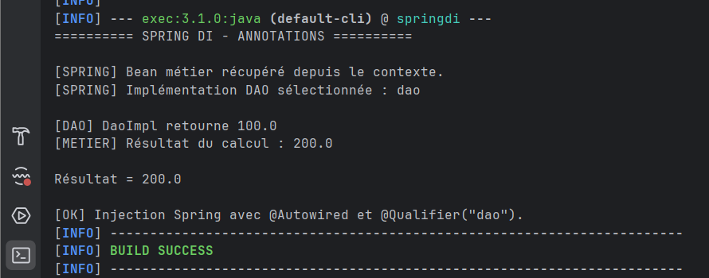
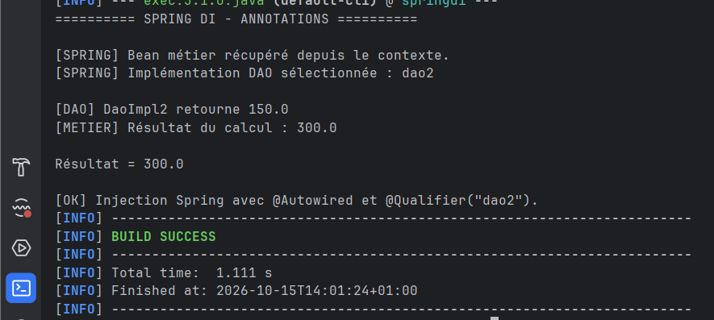
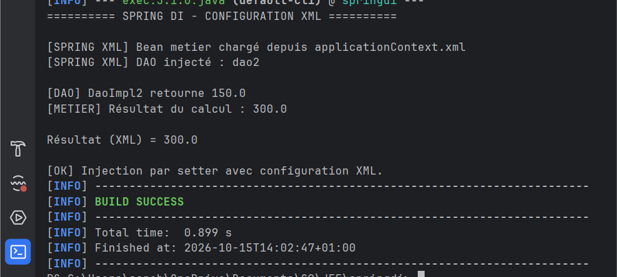
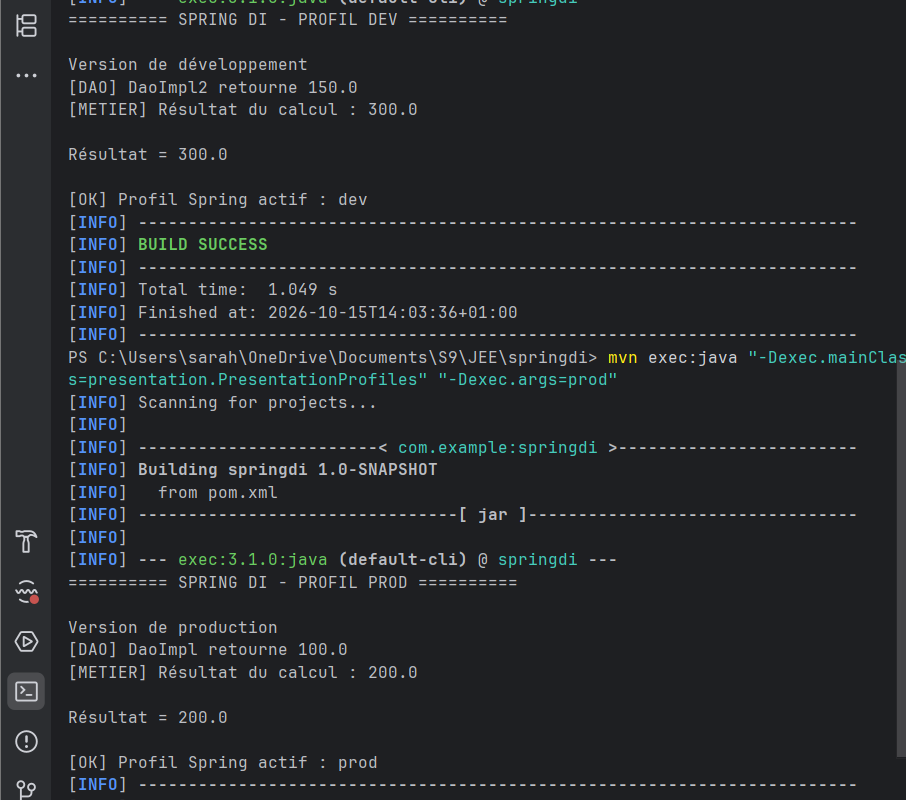

# Spring IoC et Injection de Dépendances

Ce TP met en pratique l’IoC et l’injection de dépendances avec Spring à travers `@Component`, `@Autowired`, `@Qualifier`, la configuration XML et les profils Spring.

---

## Injection par annotations avec `dao`

`DaoImpl`, sélectionné avec `@Qualifier("dao")`, retourne `100.0`, ce qui donne un résultat final de `200.0`.



---

## Injection par annotations avec `dao2`

`DaoImpl2`, sélectionné avec `@Qualifier("dao2")`, retourne `150.0`, ce qui donne un résultat final de `300.0`.



---

## Configuration XML

Spring charge les beans depuis `applicationContext.xml` et injecte `dao2` dans la couche métier via le setter.



---

## Profils Spring

Les profils permettent de changer d’implémentation selon l’environnement :

- `dev` → `DaoImpl2` → `300.0`
- `prod` → `DaoImpl` → `200.0`



---

## Technologies

- Java 17
- Maven
- Spring Context 6.1.2
- JUnit 4.13.2

---

## Exécution

```bash
mvn clean test
```
